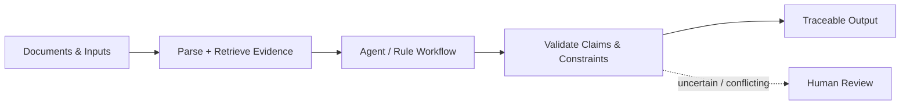

<strong>Applied AI Engineer · Agentic Systems · LLM Reliability</strong>

Building AI systems that are evidence-grounded, testable, and useful beyond a demo.

  
  
  

---

## About

I’m a B.E. Information Science student at **Dayananda Sagar College of Engineering, Bengaluru** (Class of 2027), focused on **AI Engineering, Agentic Systems, and LLM Reliability**. I build applications across retrieval, agent workflows, evaluation, and backend engineering—with an emphasis on evidence-grounded outputs and dependable system behaviour.

- **Building:** RAG / GraphRAG applications, agentic workflows, and reliable APIs.
- **Engineering for:** Source traceability, bounded execution, measurable behaviour, and clear failure handling.
- **Interested in:** Applied AI, LLM reliability, and production-minded systems design.

## Featured systems

<table>
  <tr>
    <td width="50%" valign="top">
      <h3><a href="https://github.com/shivarajsg/PreAuth">MedRule · Prior Authorization</a></h3>
      Clinical-document decision support that evaluates extracted evidence against structured policy rules.
        
      Python · Flask · PyMuPDF · Rule engine
    </td>
    <td width="50%" valign="top">
      <h3><a href="https://github.com/shivarajsg/TenderBid">TenderBid AI</a></h3>
      Agent-assisted tender intelligence for organising complex RFP requirements into compliance workflows.
        
      FastAPI · React · TypeScript · PostgreSQL · LangGraph
    </td>
  </tr>
  <tr>
    <td width="50%" valign="top">
      <h3><a href="https://github.com/shivarajsg/graphrag-knowledge-pipeline">GraphRAG Knowledge Pipeline</a></h3>
      Document-grounded question answering with knowledge-graph retrieval and citation validation.
        
      Python · PyMuPDF · NetworkX · Streamlit
    </td>
    <td width="50%" valign="top">
      <h3><a href="https://github.com/shivarajsg/ReliaLM">ReliaLM</a></h3>
      Reliability experiments for structured generation and tool-calling behaviour in language models.
        
      PyTorch · Transformers · QLoRA · FastAPI
    </td>
  </tr>
  <tr>
    <td width="50%" valign="top">
      <h3><a href="https://github.com/shivarajsg/autonomous_multi_agentic_ai">Autonomous Coding Agents</a></h3>
      A planner–executor–critic workflow with feedback, bounded retries, and isolated code execution.
        
      Python · LangGraph · Docker · FastAPI
    </td>
    <td width="50%" valign="top">
      <h3><a href="https://github.com/shivarajsg/OIL-Is-Well">Nearby Wells Intelligence System</a></h3>
      A Smart India Hackathon project that turns drilling and well reports into nearby-well decision support.
        
      FastAPI · Next.js · PostgreSQL · Google GenAI
    </td>
  </tr>
</table>

Each repository contains the implementation, setup instructions, and technical details.

## How I structure AI systems

I aim to keep probabilistic model outputs inside clear system boundaries: retrieval supplies evidence, workflows control execution, validators check important claims, and unresolved cases stay visible instead of being silently guessed.

## Engineering dashboard

  

Generated from GitHub public-repository metadata and refreshed daily by GitHub Actions. Language bars count repositories by GitHub's primary-language field, not lines of code.

## Toolkit

  

  
<strong>Skills by area</strong>

  | Area | Technologies and concepts |
  |---|---|
  | **AI & orchestration** | LLM applications, RAG, GraphRAG, LangChain, LangGraph, Hugging Face, PyTorch |
  | **Retrieval & knowledge** | Knowledge graphs, embeddings, FAISS, ChromaDB, document parsing, citation validation |
  | **Backend & data** | Python, FastAPI, Flask, Pydantic, SQLAlchemy, PostgreSQL, Supabase, MongoDB, REST APIs |
  | **Frontend** | React, Next.js, TypeScript, JavaScript, Tailwind CSS, Vite |
  | **Engineering** | Docker, Git, GitHub Actions, Linux, pytest, API testing |

## Contribution activity

  <picture>
    <source media="(prefers-color-scheme: dark)" srcset="https://raw.githubusercontent.com/shivarajsg/shivarajsg/output/github-snake-dark.svg" />
    <source media="(prefers-color-scheme: light)" srcset="https://raw.githubusercontent.com/shivarajsg/shivarajsg/output/github-snake.svg" />
    
  </picture>

**Let’s build something useful.**

<a href="https://www.linkedin.com/in/shivaraj-tech9353/">LinkedIn</a> ·
<a href="mailto:kshivaraj784@gmail.com">Email</a> ·
<a href="https://github.com/shivarajsg">GitHub</a>

Evidence-grounded AI · Thoughtful systems · Always learning

