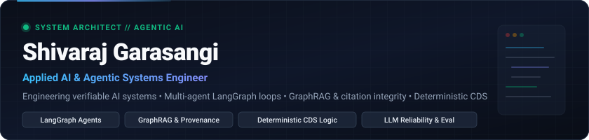
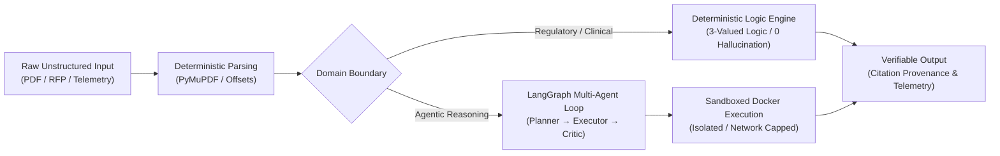

<div align="center">



<br/>

[](https://www.linkedin.com/in/shivaraj-tech9353/)
[](mailto:kshivaraj784@gmail.com)
[](https://github.com/shivarajsg)
[](https://github.com/shivarajsg)

<br/>

**Engineering verifiable, evidence-grounded AI systems, deterministic decision engines, and resilient multi-agent architectures.**

</div>

---

### 👨‍💻 Engineering Perspective

I am an Applied AI & Software Engineer pursuing a B.E. in Information Science with a specialization in Data Science & Analytics at Dayananda Sagar College of Engineering, Bengaluru (Class of 2027).

Most generative AI demos break the moment they meet production reality: probabilistic models hallucinate critical numbers, agents loop uncontrollably without guardrails, and RAG pipelines retrieve irrelevant chunks without verifiable source attribution. 

My engineering focuses on solving these failure modes from first principles:
- **Verifiability over vibes:** In mission-critical domains (healthcare, regulatory compliance, legal, and enterprise procurement), probabilistic generation must be bounded by deterministic decision rules, three-valued logic, and character-level citation provenance.
- **Agentic systems with teeth:** Moving beyond toy prompt chains to stateful LangGraph state machines featuring explicit sandboxing (disposable Docker containers), critic-driven self-correction, bounded retry budgets, and persistent memory stores.
- **Systems-first AI engineering:** AI models are only 5% of a reliable application. The remaining 95% is robust software engineering: clean API design (FastAPI), strict schema enforcement (Pydantic), efficient vector search (ChromaDB/FAISS), transactional persistence (PostgreSQL), and observable telemetry.

---

### 🏛️ Featured Engineering Systems

Here is a curated selection of systems I've architected and implemented, demonstrating verifiable AI pipelines, agent orchestration, and deterministic logic.

---

#### 1. [MedRule — Prior-Authorization Clinical Decision Support Engine](https://github.com/shivarajsg/PreAuth)
> **Deterministic healthcare CDS system evaluating prior-authorization requests with a strict zero-hallucination invariant.**

[](https://medrule-preauth.onrender.com)
[-success?style=flat-square)](https://medrule-preauth.onrender.com/api/health)
[](https://github.com/shivarajsg/PreAuth)

- **The Problem:** Healthcare prior-authorization is slow, manual, and high-stakes. Relying on probabilistic LLMs risks severe hallucinations and regulatory violations when adjudicating clinical policies.
- **The Architecture:** Executes **100% deterministic, three-valued logic (`TRUE`, `FALSE`, `UNKNOWN`)** compiled directly from authoritative clinical guidelines (Centene & Evolent Health) across 9 medical specialties. Uses local high-performance PDF intake (`PyMuPDF`) to extract EHR clinical variables (CPT/HCPCS, ICD-10, physical exam criteria) and match them against 372 rule nodes with complete audit traceability.
- **Key Engineering:** Enforces a non-negotiable invariant—**0 auto-approvals without deterministic criteria satisfaction**. Built-in clinical telemetry dashboard, SME human-review queue for edge cases, and automated concordance benchmarks.
- **Stack:** Python 3.11, PyMuPDF, Render, WSGI/Flask, Pytest, Gunicorn.

---

#### 2. [GraphRAG Document Intelligence & Knowledge Graph Pipeline](https://github.com/shivarajsg/graphrag-knowledge-pipeline)
> **Production-grade document-grounded AI combining Knowledge Graph construction, claim-level citation validation, and regulatory table reasoning.**

[](https://github.com/shivarajsg/graphrag-knowledge-pipeline)
[](https://www.python.org/)
[](https://streamlit.io/)

- **The Problem:** Traditional dense-vector RAG fails on deeply structured regulatory texts, cross-page tables, and nested constraints, frequently producing plausible-sounding answers with non-existent citations.
- **The Architecture:** Ingests complex PDFs with layout preservation and exact physical character/page offset tracking (`PyMuPDF`). Builds a multi-relational Knowledge Graph with multi-passage cross-reference assembly. Enforces strict document-grounded question answering with controlled execution statuses (`answered`, `partially_answered`, `insufficient_evidence`, `conflicting_evidence`).
- **Key Engineering:** Includes an independent **Citation Validator** verifying verbatim provenance bounds and an **NLI Claim Verifier** checking for semantic contradictions. Features a specialized three-valued Table Reasoner capable of parsing modifying footnotes and conditional taxonomic constraints (e.g., CITES Appendices).
- **Stack:** Python, PyMuPDF, NetworkX, Graph Query Engine, Streamlit, Pytest.

---

#### 3. [TenderBid AI — Agentic Tender Intelligence & Compliance Platform](https://github.com/shivarajsg/TenderBid)
> **Multi-agent procurement intelligence platform that transforms 200+ page government and enterprise RFPs into automated compliance matrices.**

[](https://github.com/shivarajsg/TenderBid)
[](https://fastapi.tiangolo.com/)
[](https://react.dev/)
[](https://www.typescriptlang.org/)
[](https://www.langchain.com/langgraph)

- **The Problem:** MSMEs forfeit critical contracts because analyzing dense tender documents for eligibility, technical requirements, and disqualifying clauses takes days of manual legal and technical review.
- **The Architecture:** Multi-agent state machine built with **LangGraph** orchestrating specialized agents: Document Intake & Normalizer, Requirement Extractor, Eligibility Adjudicator, and Compliance Matrix Generator.
- **Key Engineering:** Integrates ChromaDB for dense semantic retrieval across segmented tender sections, PostgreSQL 16 for structured clause tracking, and Google Gemini for structured schema extraction. Delivers clause-level compliance scores, risk flags, and instant executive summaries.
- **Stack:** Python 3.13, FastAPI, React 18, TypeScript, TailwindCSS, PostgreSQL 16, ChromaDB, Docker, LangGraph.

---

#### 4. [ReliaLM — Reliability Engineering Framework for LLM Agents](https://github.com/shivarajsg/ReliaLM)
> **Empirical framework measuring, evaluating, and mitigating structured output and function-calling failures in open-weight LLMs.**

[](https://github.com/shivarajsg/ReliaLM)
[](https://huggingface.co/Qwen)
[-ff69b4?style=flat-square)](https://github.com/shivarajsg/ReliaLM)

- **The Problem:** LLM agents collapse when models output malformed JSON, violate parameter schemas, or hallucinate non-existent tool functions.
- **The Architecture:** A double-phase reliability benchmarking and fine-tuning suite for open-weight models (`Qwen2.5-7B-Instruct`). Implements an automated **Failure Classifier Engine** that categorizes agent errors into structural (`malformed_json`, `schema_violation`) and semantic (`wrong_tool`, `hallucinated_parameter`, `wrong_field_value`) modes.
- **Key Engineering:** Evaluates zero-shot baselines against QLoRA adapters (ranks 8 and 16) across 5 deterministic Python mock execution environments (`search_repo`, `read_docs`, `create_issue`, `run_tests`, `summarize_pr`). Packaged as a high-throughput, containerized FastAPI evaluation microservice.
- **Stack:** Python, PyTorch, Hugging Face Transformers, PEFT / QLoRA, FastAPI, Docker, Pytest.

---

#### 5. [Autonomous Multi-Agent AI System — Self-Correcting Coding Loop](https://github.com/shivarajsg/autonomous_multi_agentic_ai)
> **Autonomous software engineering agent loop: Planner → Executor → Critic → Memory with Docker container sandboxing.**

[](https://github.com/shivarajsg/autonomous_multi_agentic_ai)
[](https://www.langchain.com/langgraph)
[](https://www.docker.com/)

- **The Problem:** Unchecked autonomous code generation risks infinite failure loops, host environment contamination, and uninspected output quality.
- **The Architecture:** Explicit LangGraph state graph coordinating four specialized agents: **Planner** (breaks tasks into directed subtasks), **Executor** (writes Python code and tests), **Critic** (executes tests and inspects AST/runtime failures), and **Memory** (distills post-execution lessons into vector storage).
- **Key Engineering:** Every generated line runs inside a disposable, network-isolated, memory-capped Docker container. Failed attempts pass structured critic diagnostics back into executor retries bounded by an explicit retry budget. Successful subtasks are committed to dedicated Git branches and streamed live via WebSockets.
- **Stack:** Python 3.11, LangGraph, LangChain, FastAPI, Docker Sandboxing, PostgreSQL 15, React, TypeScript.

---

#### 🌐 Domain Spotlight: [Nearby Wells Intelligence System (NWIS)](https://github.com/shivarajsg/OIL-Is-Well)
*Smart India Hackathon (SIH Problem Statement 26121) for Oil India Limited (OIL)*
- Built an operational decision-support copilot for Oil India Limited's eRTMAC platform, converting hundreds of unstructured Well Completion Reports (WCR) and Daily Drilling Reports (DDR) into institutional memory.
- Implemented real-time depth-interval hazard matching (1–25 km radius) with live telemetry streaming and resilient **4-slot Gemini API key rotation with automatic failover** on quota exhaustion.
- **Stack:** FastAPI, Google GenAI SDK (`gemini-3.5-flash-lite`), Supabase / PostgreSQL, Docker Compose, Next.js.

---

### 🛠️ Technical Capabilities & Stack

Curated according to technologies verified across active repositories and engineering implementations:

```
┌─────────────────────────────────┬──────────────────────────────────────────────────────────────────┐
│ Engineering Domain              │ Technologies & Methodologies                                     │
├─────────────────────────────────┼──────────────────────────────────────────────────────────────────┤
│ Agentic AI & Orchestration      │ LangGraph (State Graphs, Cycles), LangChain, Multi-Agent Teams,  │
│                                 │ Critic Loops, Sandboxed Execution, Agent Vector Memory           │
├─────────────────────────────────┼──────────────────────────────────────────────────────────────────┤
│ Retrieval & Knowledge Systems   │ GraphRAG, Knowledge Graphs, ChromaDB, FAISS, PyMuPDF Layout      │
│                                 │ Offset Extraction, Claim-Level NLI Verification, Three-Valued QA │
├─────────────────────────────────┼──────────────────────────────────────────────────────────────────┤
│ LLM Reliability & Evaluation    │ QLoRA Fine-Tuning (PEFT), Failure Taxonomy Classification,        │
│                                 │ Zero-Hallucination Invariants, Deterministic CDS Rule Engines    │
├─────────────────────────────────┼──────────────────────────────────────────────────────────────────┤
│ Backend & APIs                  │ Python (3.11–3.13), FastAPI, Flask, Pydantic, SQLAlchemy,       │
│                                 │ WebSockets, RESTful API Architecture, AsyncIO                    │
├─────────────────────────────────┼──────────────────────────────────────────────────────────────────┤
│ Frontend & Data Visualization   │ React 18, TypeScript 5, Next.js, TailwindCSS, Vite, Streamlit   │
├─────────────────────────────────┼──────────────────────────────────────────────────────────────────┤
│ Infrastructure & Data Stores    │ Docker & Docker Compose, Kubernetes (GKE), PostgreSQL, Supabase,  │
│                                 │ Git/GitHub Actions CI, Linux/Bash, Pytest Test Suites            │
└─────────────────────────────────┴──────────────────────────────────────────────────────────────────┘
```

> **Currently exploring / active research:** Distributed inference optimization, MCP (Model Context Protocol) servers, and hybrid dense/sparse BM25 + Graph vector fusion.

---

### 📐 How I Approach Engineering



1. **Deterministic boundaries for probabilistic models:** LLMs are exceptional at semantic synthesis, parsing ambiguity, and intent classification. They should never be the sole authority on compliance thresholds, arithmetic, or clinical rules.
2. **Isolation and sandboxing by default:** Autonomous agents write code; that code must execute in disposable, memory-capped, network-restricted containers. No exceptions.
3. **Traceability to the character level:** An answer without an exact verifiable source reference is a liability. Every extracted insight must link back to physical page bounds and verbatim quotes.
4. **Architectural observability:** Production systems demand real-time telemetry—health endpoints, rule execution logs, failure classifiers, and token expenditure monitoring.

---

### 📊 GitHub Activity & Statistics

<div align="center">


&nbsp;&nbsp;


</div>

---

### 📬 Get in Touch

I am actively interested in **AI Engineering, Applied AI, Agentic Systems, and Backend Software Engineering** roles where technical rigor, systems thinking, and verifiable architectures matter.

- **LinkedIn:** [linkedin.com/in/shivaraj-tech9353](https://www.linkedin.com/in/shivaraj-tech9353/)
- **Email:** [kshivaraj784@gmail.com](mailto:kshivaraj784@gmail.com)
- **GitHub:** [github.com/shivarajsg](https://github.com/shivarajsg)
- **Location:** Bengaluru, India

<div align="center">
<sub>Designed with precision for technical rigor • Built with Markdown, SVG &amp; Mermaid</sub>
</div>
